<a href="https://www.missdantella.com"><picture><source media="(max-width: 640px)" srcset="./assets/banner-mobile.svg" /></picture></a>

<a href="https://github.com/M1D0-Technologies/dahhan-enterprises">Dahhan Enterprises</a> · <a href="https://github.com/M1D0-Technologies/dahhan-industries">Dahhan Industries</a> · <b>Miss Dantella</b> · <a href="https://github.com/M1D0-Technologies/m1d0-technologies">M1D0 Technologies</a> · <a href="https://github.com/M1D0-Technologies/platform-engineering">Platform Engineering</a> · <a href="https://github.com/M1D0-Technologies">Organization</a>

# Miss Dantella

Miss Dantella develops women's lingerie, underwear and nightwear collections for wholesale partners and individual customers. Bringing together product development, apparel production and commerce, the brand serves both B2B wholesale and B2C retail markets.

Building on Dahhan's earlier lingerie wholesale business, Miss Dantella established its own identity in 2000 and expanded into consumer markets. Its collections incorporate fabrics, lace, elastics and accessories supplied by Dahhan Industries, connecting textile expertise with finished apparel.

Within the wider Dahhan business represented internationally by Dahhan Enterprises, Miss Dantella maintains its own brand identity, product direction and commercial relationships, with a continued focus on developing its collections, wholesale partnerships and customer experience.

## At a glance

<picture><source media="(max-width: 640px)" srcset="./assets/glance-mobile.svg" /></picture>

## Links

<a href="https://www.missdantella.com"><picture><source media="(max-width: 640px)" srcset="./assets/tiles/web-mob.svg" /></picture></a><a href="https://www.linkedin.com/company/missdantella/"><picture><source media="(max-width: 640px)" srcset="./assets/tiles/li-mob.svg" /></picture></a>

Documentation and showcase material only; product source code is kept private. © 2026 Dahhan Enterprises LLC. All rights reserved.
